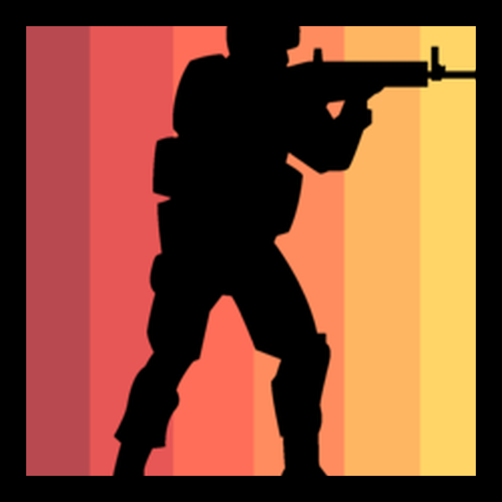
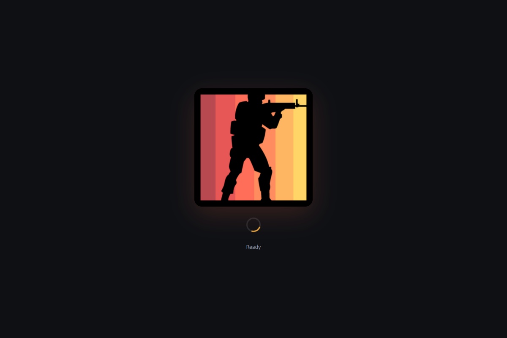
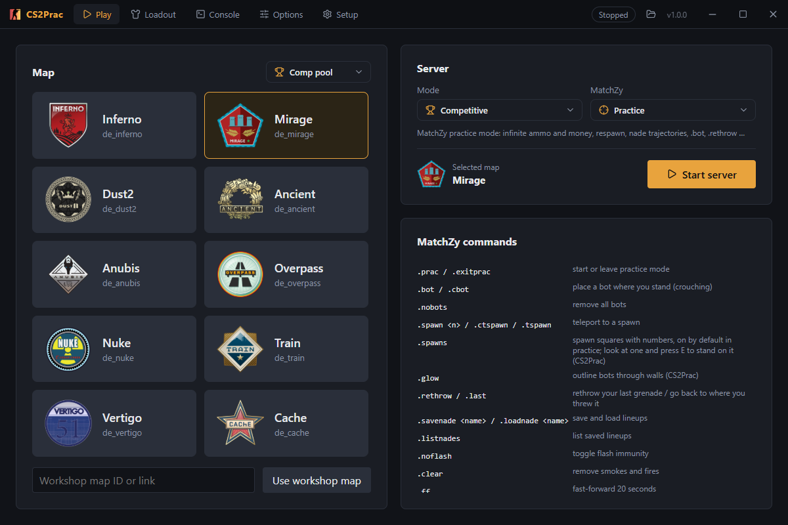
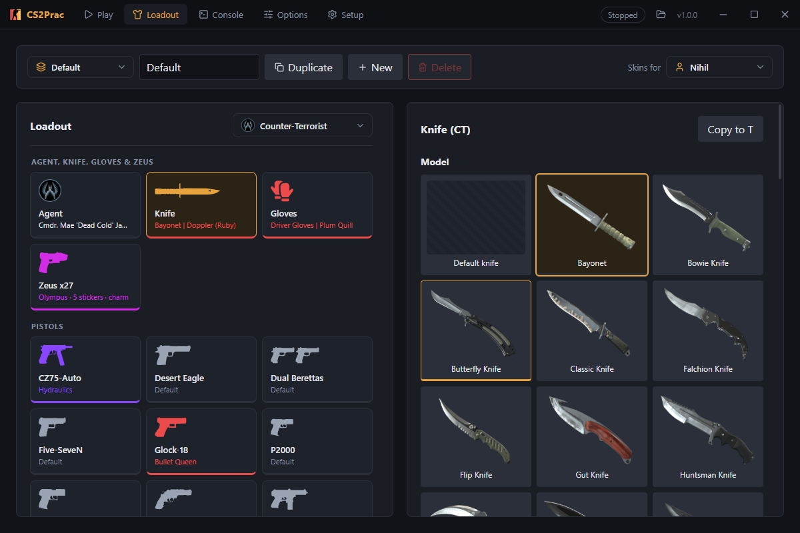
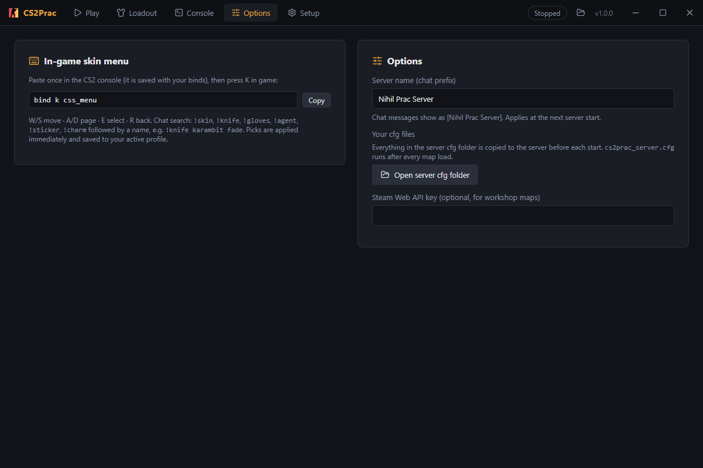
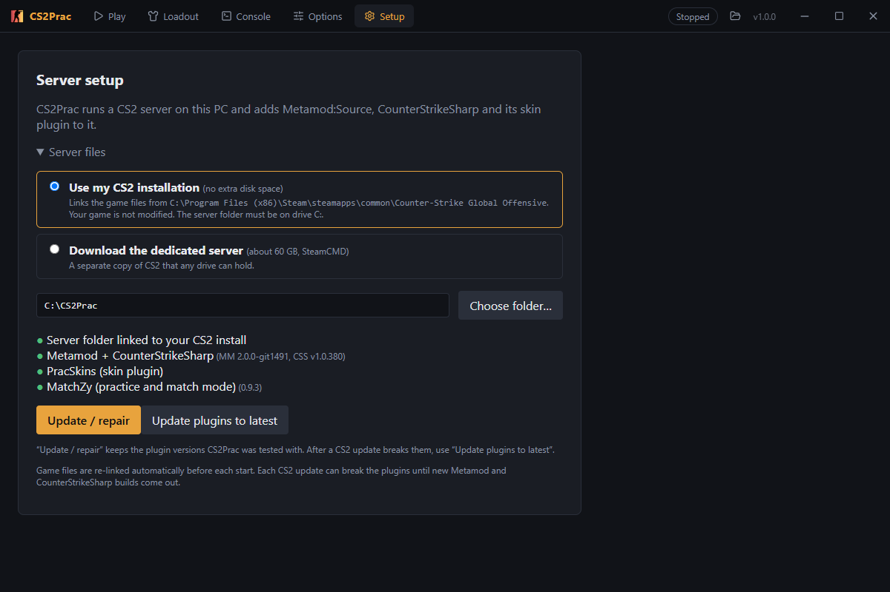

<p align="center">
  
</p>

<h1 align="center">CS2Prac 1.0.0</h1>

<p align="center">
  <b>Your own CS2 practice server, one click away.</b><br/>
  Pick a map, start the server, join from CS2, and you're admin, with every skin you want.
</p>

---

## ✨ What is CS2Prac?

CS2Prac is a Windows app that runs a **private CS2 practice server on your own PC**. There's nothing to configure by hand:
Metamod, CounterStrikeSharp and MatchZy come inside the installer, and the server uses the CS2 you already have installed,
so it takes **almost no extra disk space**.

- 🗺️ **Any map**: the whole competitive pool, other official maps, or any Workshop map
- 🎯 **MatchZy practice mode**: infinite ammo, nade trajectories, `.bot`, `.rethrow`, saved lineups and more
- 🔪 **Every skin**: weapons, knives, gloves, agents, stickers and charms, per team
- 🛡️ **You're admin**: every Steam account on your PC gets full rights
- 🔄 **Auto-updates**: new versions download in the background

---

## 🚀 Getting started



1. Download **`CS2Prac-Setup-1.0.0.exe`** below and run it.
   > Windows SmartScreen may warn you because the installer isn't code-signed. Click **More info → Run anyway**.
2. Open CS2Prac and click **Set up** once. If CS2 is installed through Steam, the rest is automatic and needs no downloads.
3. Pick a map, press **Start server**, then type the `connect` line the app shows into the CS2 console.

<br clear="right"/>

---

## 🗺️ Play

Choose a map with its official icon, pick **Competitive**, **Casual**, **Wingman** or **Deathmatch**, and choose how
MatchZy runs: **Practice**, **Match** (warmup, `.ready`, knife round, pauses) or **Plain**. The most useful practice commands are listed right next to the Start button.



**Practice extras made for CS2Prac:**

| Command | What it does |
| --- | --- |
| `.spawns` | Shows every competitive spawn as a numbered square on the floor. Look at one and press **E** to stand on it. |
| `.glow` | Outlines bots through walls, great for checking angles and lineups. |
| `.movement` | Movement practice: record where a jump starts (`.movement save <name>`) and where it lands (`.movement end`). Fall and you're instantly back at the start; land on the end square and it counts as made. Shows made/attempts, no fall damage. `.next` / `.prev` switch spots. |
| `!cmd <command>` | Runs any server command, e.g. `!cmd exec mycfg` or `!cmd mp_roundtime 60`. |

---

## 🔪 Loadout

Set up skins for **Counter-Terrorists and Terrorists separately**: agent, knife, gloves, every gun, plus up to
five stickers and a charm per weapon. Keep several profiles and switch between them. Right-click a skin for the
detailed editor: wear, pattern, StatTrak™, name tag, stickers and charm.



Changes apply **instantly** on a running server; you don't need to reconnect.

### 🎮 Skins without leaving the game

Bind the skin window once in the CS2 console:

```
bind k css_menu
```

Press **K** in game to open a real skin window: tabs for guns, knives, gloves and agents, image tiles for every finish,
and one click to equip. The **agent preview** even shows your agent in third person, standing or crouching, holding
any weapon type, from a knife or pistol to a rifle, a grenade or the C4. Everything you pick in game is saved to your profile in the app too.

Prefer typing? `!skin`, `!knife`, `!gloves`, `!agent`, `!sticker` and `!charm` search by name,
e.g. `!knife karambit fade`.

---

## ⚙️ Options and Setup

<table>
<tr>
<td width="50%"></td>
<td width="50%"></td>
</tr>
<tr>
<td><b>Options</b>: name your server (it shows as the chat prefix), open the server cfg folder for your own configs,
and add a Steam Web API key for Workshop maps.</td>
<td><b>Setup</b>: use your existing CS2 install (default, no extra space) or download a separate 60 GB dedicated server.
<b>Update / repair</b> fixes things after a CS2 update.</td>
</tr>
</table>

---

## 🧰 Also in 1.0.0

- 🖼️ New app icon, a start-up screen while everything loads, and a **Server starting** screen when you press Start
- 🪟 No console windows popping up: the server runs completely in the background
- 🩺 Health check after every start, with a clear notice if CS2 updated or the server stopped unexpectedly
- 📄 Your own `.cfg` files: drop them in the server cfg folder; `cs2prac_server.cfg` runs after every map load
- 📜 **Console** tab with the live server output, and a **Logs** button in the top bar

---

## 🔒 Is it safe?

- The server is a **private LAN server** (`-insecure`, `sv_lan 1`) that only runs on your PC. It's meant for practice
  on your own machine, not for public play.
- Skins are applied **by the server**. CS2Prac never reads or changes your game's memory.
- Your CS2 install is left alone. The only thing added to it is the two small files of the K skin window.
- Settings, loadouts and logs live in `%APPDATA%\CS2Prac` and survive updates and reinstalls.

---

## 📋 Requirements

- Windows 10 or 11
- CS2 installed through Steam, with the server folder on the **same drive** as CS2
  (or ~60 GB free for the separate dedicated server option)

## ⚠️ Good to know

- After a big CS2 update, skins or plugins can stop working until Metamod and CounterStrikeSharp release new builds.
  Use **Setup → Update / repair**, or **Update plugins to latest** if that doesn't help.
- After CS2Prac updates the skin window, restart CS2 once so it picks up the new version.

---

## 🙏 Credits

Built on [Metamod:Source](https://www.sourcemm.net/), [CounterStrikeSharp](https://github.com/roflmuffin/CounterStrikeSharp)
and [MatchZy](https://github.com/shobhit-pathak/MatchZy). Skin data from [ByMykel/CSGO-API](https://github.com/ByMykel/CSGO-API);
the skin technique follows [cs2-WeaponPaints](https://github.com/Nereziel/cs2-WeaponPaints). Their licenses ship with the app.
