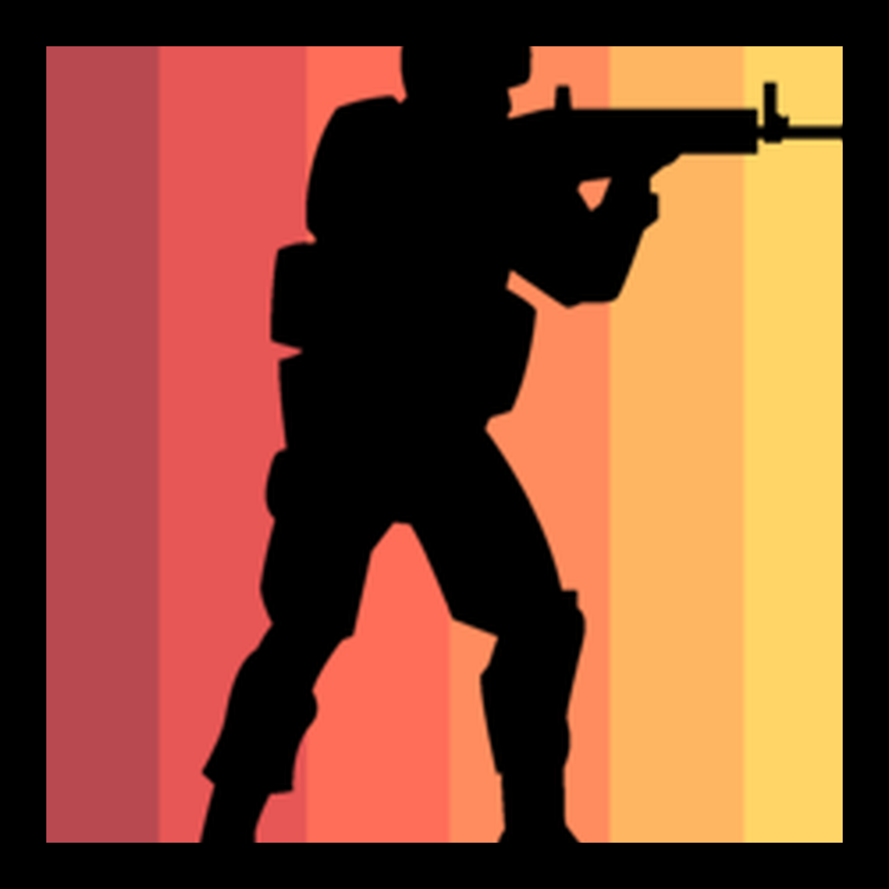

  

<h1 align="center">CS2Prac 1.5.0</h1>

  <b>Your practice server, now with a lot more in it.</b> 
  Server settings in game, pins, music kits, graffiti, your own bots, lineups, Workshop browsing and a 3D skin editor.

---

## ⬆️ Updating

Installed 1.0.0? CS2Prac updates itself in the background. You can also install `CS2Prac-Setup-1.5.0.exe` over the old version.
Windows SmartScreen may warn about an unknown publisher: click **More info → Run anyway**.

> **Restart CS2 once after updating.** The K and L windows have a new layout, and CS2 keeps the old one cached until a
> restart. The Play page tells you when it's needed.

---

## ⚙️ Server settings window (L)

Bind `l` to `css_pracmenu` and press it in game to open a full settings window:

- **Toggles**: bot glow, spawn markers, bot radio, infinite ammo, buy anywhere, grenade trajectories, impacts, no flash,
  god mode, auto bunnyhop, friendly fire, fall damage
- **Choices**: bot difficulty, whether bots shoot, round and freeze time (also for the round that's running), gravity,
  timescale, bot stop and crouch
- **Sky**: swap the map's skybox (thumbnails rendered from your own CS2 files in the app)
- **Map** and **Bots** tabs: change map (official and recent Workshop maps), place and kick bots
- **Spots** and **Nades** tabs: movement spots and your saved lineups, one click to go there
- Every setting is saved **for every map** or **just this map**, and the app's Play page edits the same values

---

## 🔪 More in your loadout

- 📌 **Pins** and 🎵 **music kits** (every collectible and kit, including the ones missing from the usual data sets).
  The K window previews a kit's MVP, main menu and round start music, for you only.
- 🎨 **Graffiti** with every tint: bind a key to `css_spray` (or type `!spray`). It's placed by the server, nothing goes
  through Steam.
- 🏷️ **Stickers tab in K**: put stickers and charms on the gun in your hand, search with `!sticker` / `!charm`
- 🔁 **T/CT switch** in the K window, so you can set the other team's skins without switching sides
- 📥 **Import `!gen` codes and inspect links** on the Loadout page (decoded locally), or `!gen <code>` in chat
- 🧊 **3D skin editor**: open a gun on the Loadout page, drag stickers and the charm right on the model, see an
  approximation of the finish. The model is read from your own CS2 install the first time.

---

## 🤖 Your own bots

The Play page has a **Bots** panel: names, clan tags and a picture per bot, for each team. Bots pick them up as they
join. Pictures show on the scoreboard and the top bar right away, and the kill feed shows no "BOT" tag.

---

## 🗺️ Maps and lineups

- **Workshop browser** on the Play page: Popular, Newest, Most subscribed, search, or paste an ID or link.
  Thumbnails and names are remembered, and recent maps are one click away. No Steam login or API key needed.
- **Lineup library**: your MatchZy `.savenade` lineups in the app. Rename, describe, delete, copy the `.importnade` code,
  and share them as a file. In game, the L window's Nades tab puts you on the spot with the grenade in hand.
- **Movement mode** spots can now be added, renamed (on-screen keyboard) and removed from the L window. Crouched spots
  put you in crouched.

---

## 🛠️ Fixes

- No more server crash when kicking bots right after `.bot`
- Client cfgs that run `play <sound>` through `!cmd` no longer crash the server
- K and L hide the HUD while open, reopen where you left them, and clicks show at once
- Bot pictures: "Could not read that image" fixed, and big images are shrunk so they always show
- Lots of smaller tweaks to the windows, the app and the startup

---

## 🔒 Still safe

Nothing in 1.5.0 touches your Steam account or the game's memory. Everything runs on your private `-insecure` LAN
server. Bot IDs are made-up numbers far above any real account, and graffiti never asks Steam to sign anything.

---

## 🙏 Credits

Built on [Metamod:Source](https://www.sourcemm.net/), [CounterStrikeSharp](https://github.com/roflmuffin/CounterStrikeSharp)
and [MatchZy](https://github.com/shobhit-pathak/MatchZy). Skin data from [ByMykel/CSGO-API](https://github.com/ByMykel/CSGO-API);
the skin technique follows [cs2-WeaponPaints](https://github.com/Nereziel/cs2-WeaponPaints). Models and finishes are read
with [ValveResourceFormat](https://github.com/ValveResourceFormat/ValveResourceFormat). Their licenses ship with the app.
