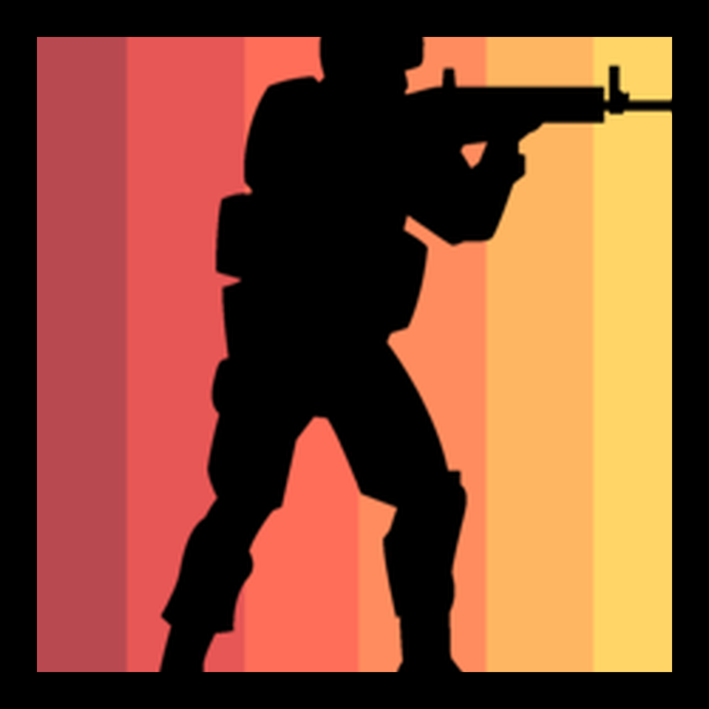

  

<h1 align="center">CS2Prac 1.6.0</h1>

  <b>Graffiti that actually shows up.</b> 
  A spray wheel on T, real spray textures and sound, and smoother gun picks in the K window.

---

## ⬆️ Updating

CS2Prac updates itself in the background. You can also install `CS2Prac-Setup-1.6.0.exe` over the old version.
Windows SmartScreen may warn about an unknown publisher: click **More info → Run anyway**.

> **Restart CS2 once after updating.** The K window has a new layout (the graffiti wheel lives in it), and CS2 keeps
> the old one cached until a restart. The Play page tells you when it's needed.

---

## 🎨 Graffiti wheel

- **Tap T** to spray your current graffiti, **hold T** to open the wheel: your recent graffiti, the one you picked,
  its name and tint, the cooldown and how many sprays you have on the map
- Pick a tint right in the wheel, or **All graffiti** to jump to the K window's Graffiti tab
- Release to spray, or **Cancel** to put the can away
- Bind it with `bind t +cs2prac_spray` (`css_spray` / `!spray` still work)

---

## 🛠️ Fixes

- **Sprays draw the real graffiti** instead of a red and black checkerboard
- **Spray sound**: every spray plays the game's own spray can sound, for everyone nearby
- Graffiti on **walls and containers** is no longer upside down
- **Picking a gun in the K window** puts it straight in your hand, with a single draw animation
- Doppler and Ultraviolet knives on the Paracord, Survival, Nomad and Skeleton show their finish

Known: a few knife finishes (e.g. Bayonet Doppler Ruby) can still show up plain. Being looked at.

---

## 🔒 Still safe

Nothing in 1.6.0 touches your Steam account or the game's memory. Graffiti is placed by your own server and never asks
Steam to sign anything.

---

## 🙏 Credits

Built on [Metamod:Source](https://www.sourcemm.net/), [CounterStrikeSharp](https://github.com/roflmuffin/CounterStrikeSharp)
and [MatchZy](https://github.com/shobhit-pathak/MatchZy). Skin data from [ByMykel/CSGO-API](https://github.com/ByMykel/CSGO-API);
the skin technique follows [cs2-WeaponPaints](https://github.com/Nereziel/cs2-WeaponPaints). Models and finishes are read
with [ValveResourceFormat](https://github.com/ValveResourceFormat/ValveResourceFormat). Their licenses ship with the app.
